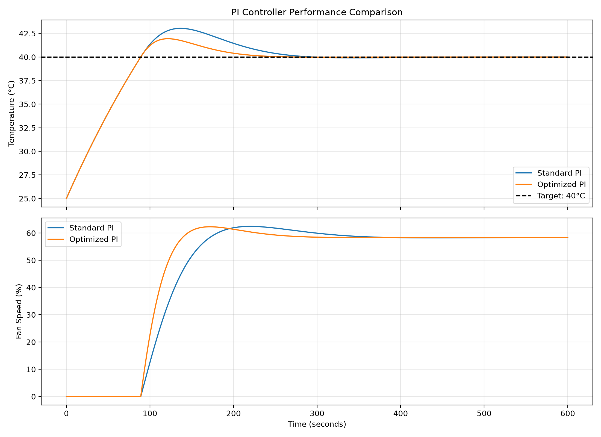
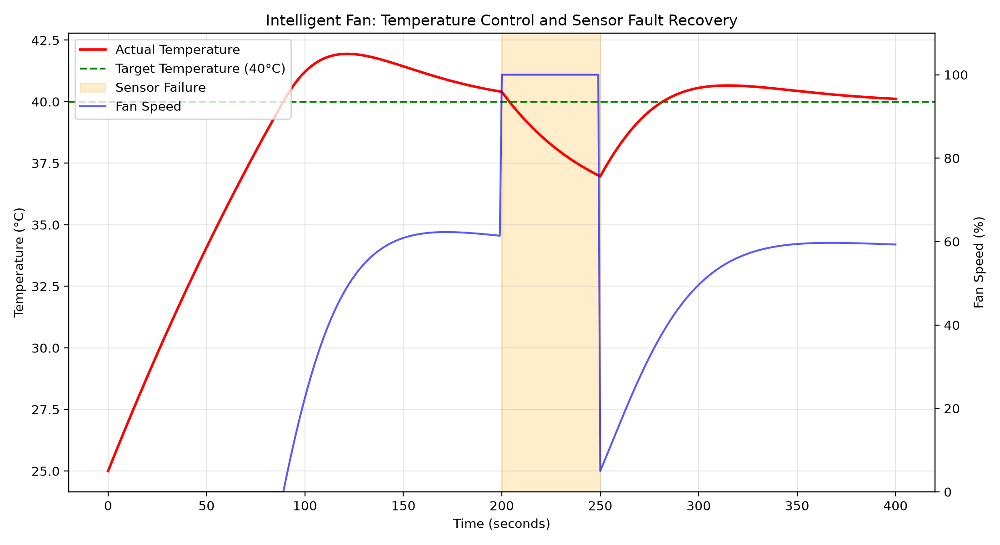
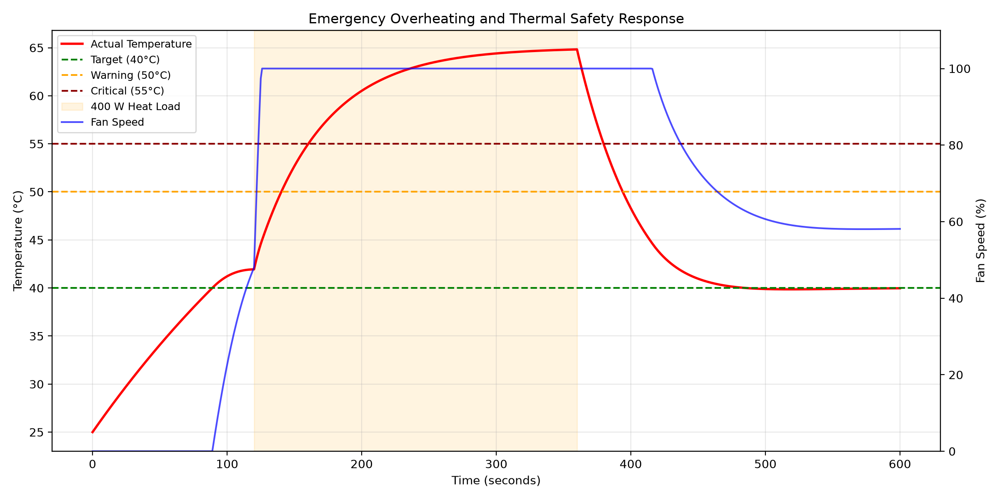

# Intelligent-Temperature-Controlled-Fan# Intelligent Temperature-Controlled Fan

A Python-based thermal management and control-system simulation demonstrating PI control, temperature regulation, thermal safety protection, sensor-fault handling, and performance optimization.

## Project Overview

This project simulates an intelligent cooling fan that automatically adjusts its speed to maintain a target temperature of **40°C**.

It combines a mathematical thermal model, feedback control, fault detection, and automated testing to demonstrate practical control-system engineering principles.

**Project type:** Software simulation  
**Language:** Python  
**Target temperature:** 40°C  
**Hardware required:** None

## Key Features

- Dynamic thermal-system simulation
- Proportional–Integral (PI) fan-speed control
- Optimized controller gains
- Variable heat-load simulation
- Automatic fan-speed adjustment
- Thermal warning and critical-temperature detection
- Sensor-failure detection and fail-safe fan commands
- Emergency overheating simulation
- Automated unit and integration tests
- Performance visualization using Matplotlib

## System Architecture

```text
       Target Temperature (40°C)
                  |
                  v
          +----------------+
          | PI Controller  |
          +----------------+
                  |
                  v
          +----------------+
          | Safety Monitor |
          +----------------+
                  |
                  v
          +----------------+
          | Fan Speed      |
          | Command (0–1)  |
          +----------------+
                  |
                  v
          +----------------+
          | Thermal Model  | <--- Heat Input
          +----------------+
                  |
                  v
          Actual Temperature
                  |
                  +------ Feedback to Controller
```

The safety monitor can override the PI controller when an unsafe condition or invalid sensor reading is detected.

## Thermal Model

The simulated temperature dynamics are based on an energy-balance equation:

\[
\frac{dT}{dt} =
\frac{Q-(h_p+h_f u)(T-T_a)}{C}
\]

Where:

- \(T\): System temperature (°C)
- \(T_a\): Ambient temperature (°C)
- \(Q\): Applied heat input (W)
- \(C\): Thermal capacity (J/°C)
- \(h_p\): Passive cooling coefficient (W/°C)
- \(h_f\): Fan cooling coefficient (W/°C)
- \(u\): Normalized fan command, from 0 to 1

The baseline simulation uses:

| Parameter | Value |
|---|---:|
| Ambient temperature | 25°C |
| Thermal capacity | 500 J/°C |
| Passive cooling coefficient | 2 W/°C |
| Fan cooling coefficient | 8 W/°C |
| Target temperature | 40°C |

## PI Controller

The PI controller adjusts fan speed based on the temperature error and accumulated error over time.

Two controller configurations were evaluated:

| Controller | Kp | Ki |
|---|---:|---:|
| Standard PI | 0.08 | 0.002 |
| Optimized PI | 0.16 | 0.004 |

### Controller Performance

Under the tested 100 W heat load:

| Metric | Standard PI | Optimized PI |
|---|---:|---:|
| Peak temperature | 43.04°C | 41.94°C |
| Temperature overshoot | 3.04°C | 1.94°C |
| Final temperature error | 0.002°C | 0.000°C |

The optimized PI controller reduced temperature overshoot by approximately **36.2%** in this simulation.

## Thermal Safety Protection

The safety system evaluates temperature readings and fan commands.

| Condition | Response |
|---|---|
| Normal temperature | PI-controlled fan speed |
| Temperature ≥ 50°C | Warning status |
| Temperature ≥ 55°C | Critical status; request maximum cooling |
| Invalid temperature reading | Sensor-fault status; request maximum cooling |
| Invalid fan command | Actuator-command fault; request maximum cooling |

These protections are implemented and evaluated in software. They do not guarantee physical hardware safety.

## Sensor Fault Simulation

A simulated sensor failure was introduced from 200 to 249 seconds.

Results:

- 50 sensor-fault samples detected
- Maximum fan speed requested for all fault samples
- Sensor status recovered at 250 seconds
- Normal PI control resumed after recovery

## Emergency Overheating Simulation

An emergency scenario applies a 400 W heat load.

Observed results:

- First warning at approximately 50.23°C
- First critical event at approximately 55.14°C
- Peak temperature approximately 64.82°C
- Final temperature approximately 39.97°C

The temperature can exceed the critical threshold even at maximum fan speed because the available cooling capacity is limited.

## Performance Graphs

### PI Controller Comparison



### Temperature Control and Sensor Fault Recovery



### Emergency Thermal Safety Response



## Automated Testing

The project includes unit and integration tests covering controller operation, thermal dynamics, fault handling, and safety behavior.

**Latest verified result: 87 tests passed.**

Run the complete test suite:

```bash
python -m unittest discover -s tests -p "test_*.py"
```

## Installation

Clone the repository:

```bash
git clone https://github.com/KAZHAP-143/Intelligent-Temperature-Controlled-Fan.git
cd Intelligent-Temperature-Controlled-Fan
```

Install Matplotlib:

```bash
python -m pip install matplotlib
```

## Running the Simulations

Temperature sensor fault simulation:

```bash
python simulations/sensor_fault_simulation.py
```

Emergency overheating simulation:

```bash
python simulations/emergency_safety_simulation.py
```

PI controller comparison graph:

```bash
python simulations/controller_comparison_plot.py
```

Temperature performance graph:

```bash
python simulations/temperature_performance_plot.py
```

Emergency performance graph:

```bash
python simulations/emergency_performance_plot.py
```

## Engineering Skills Demonstrated

- Control-system modeling
- PI controller design and tuning
- Numerical thermal simulation
- Feedback control
- Fault detection and fail-safe command logic
- Simulation-based verification
- Automated Python testing
- Engineering performance analysis
- Git and GitHub version control

## Limitations and Future Improvements

This project is simulation-based and has not been validated on physical hardware.

Potential extensions include PID control, sensor-noise modeling, fault latching, fan-actuator feedback, hardware-in-the-loop testing, and controller optimization across multiple operating conditions.

## Author

**KAZHAP-143**

[GitHub Repository](https://github.com/KAZHAP-143/Intelligent-Temperature-Controlled-Fan)